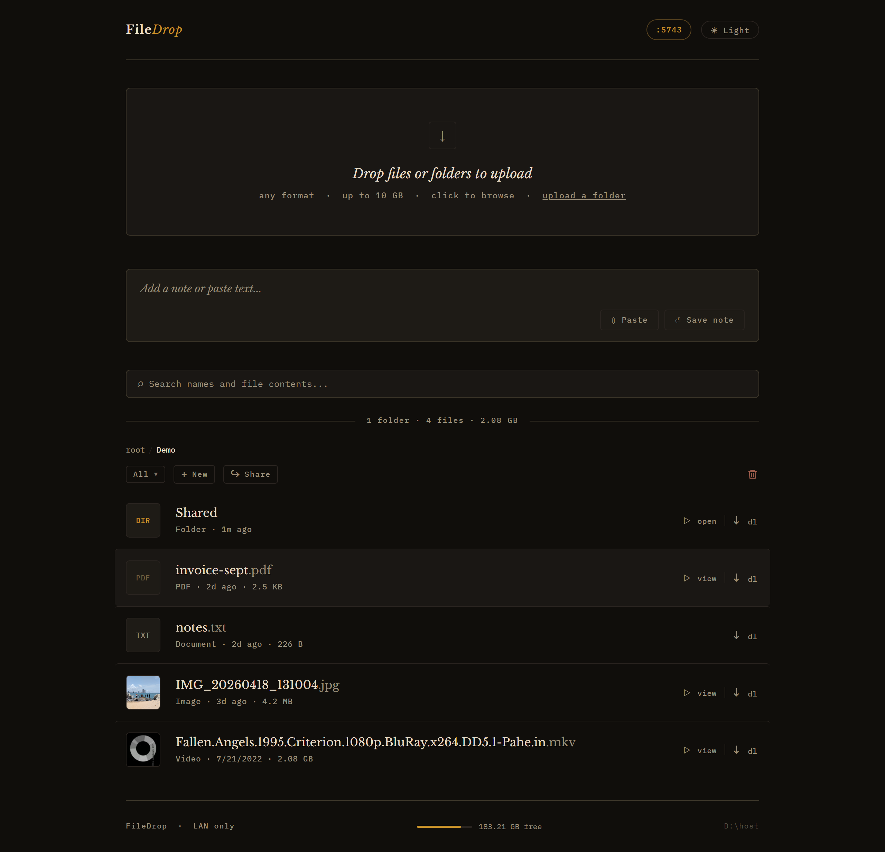
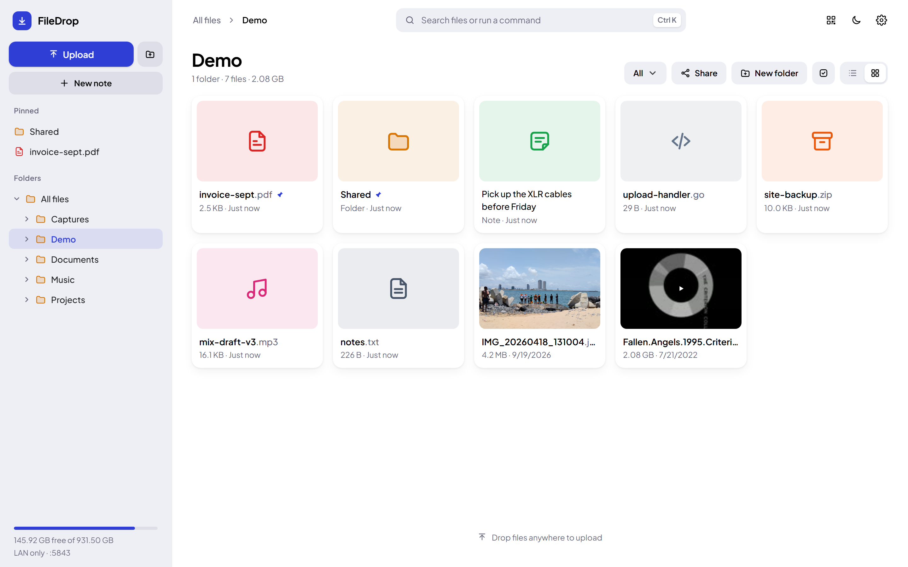
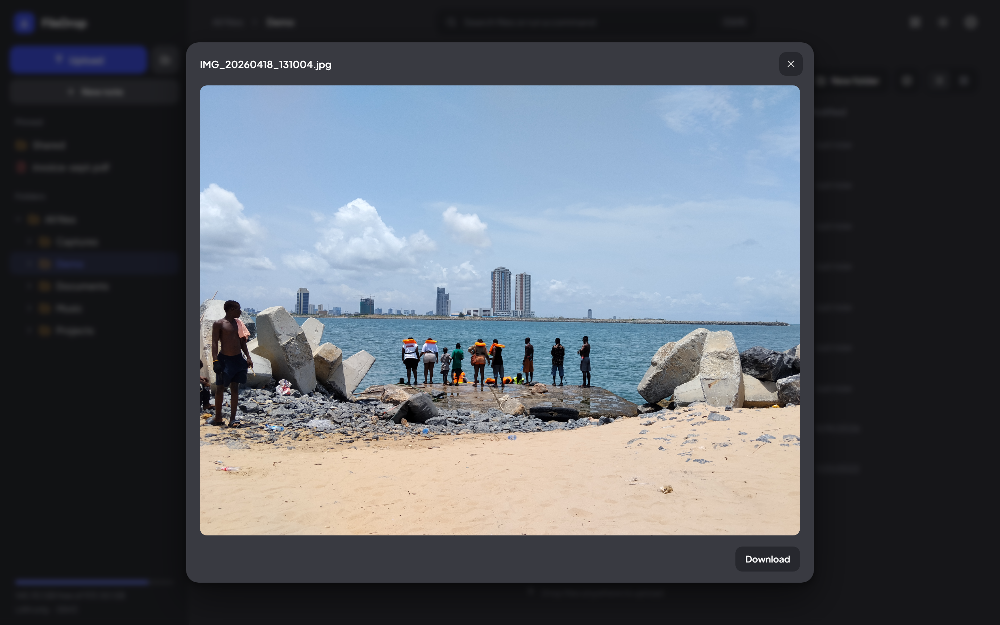
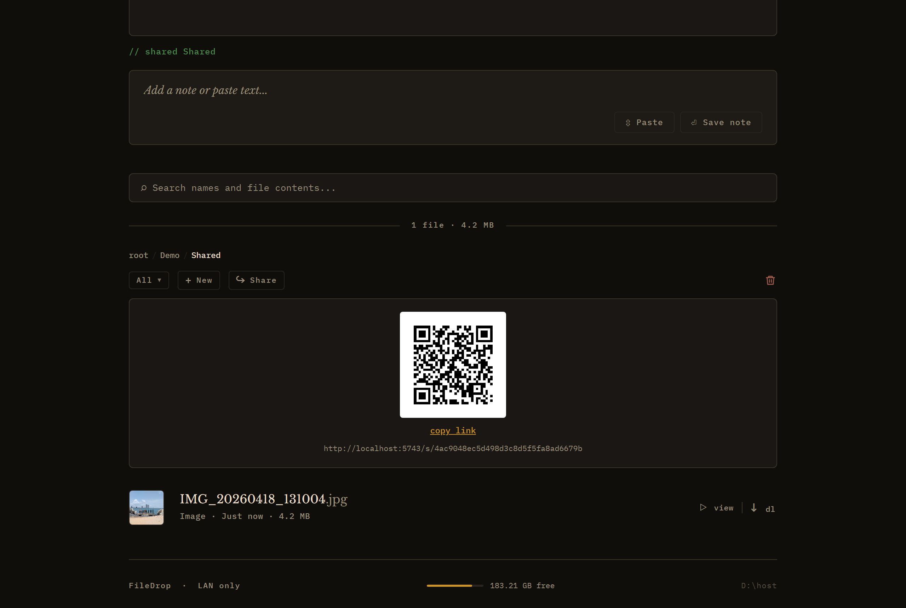
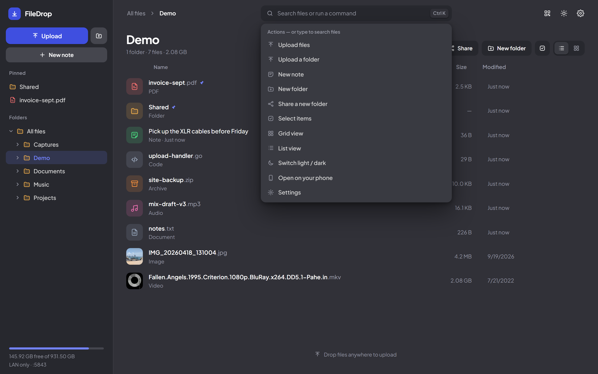
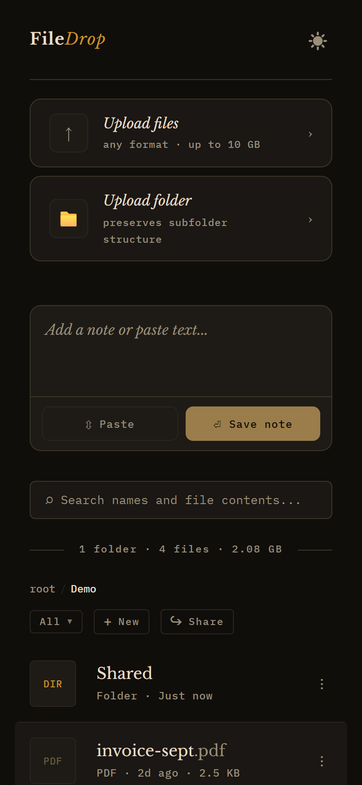
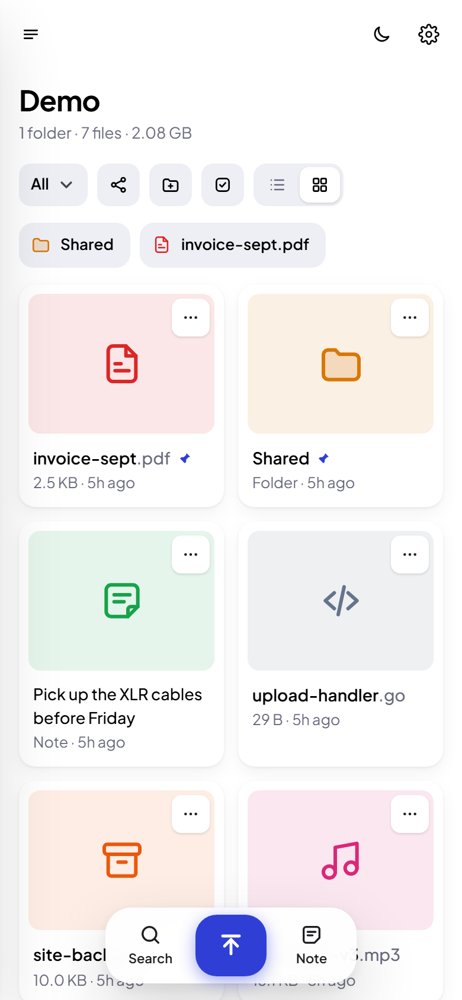
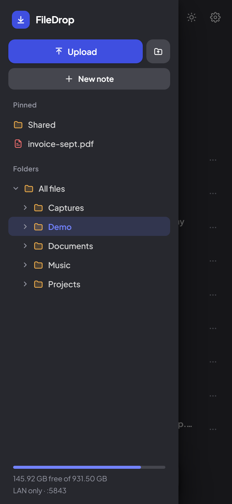

# FileDrop

A self-hosted file-drop server for Windows. Upload files, paste notes, and share across your local network or publicly over the internet — no third-party cloud, no accounts, no size cap beyond disk space.

Runs two independent servers from a single binary: a private LAN server for your local network and an optional public server exposed via Cloudflare Tunnel with its own password and session. The public server can serve from a local folder or, if configured, directly from a Cloudflare R2 bucket.



## Features

- Drop files anywhere in the window to upload, or use the Upload button (up to 10 GB per file); upload a whole folder with its structure
- Sidebar with the full folder tree — drag a file onto any folder to move it
- Pin files and folders: they stay at the top of their folder and in the sidebar's Pinned list
- List and grid views, color-coded file types, and thumbnails for images and videos
- Command bar (Ctrl+K) that searches file names and the contents of text files, and runs actions like New folder or Upload
- Inline preview for images, video, audio and PDF; video in formats browsers can't play (e.g. MKV) is converted on the fly when ffmpeg is available
- Notes: save text without creating a file, edit them in place; paste an image into a note to upload it
- Filter by extension, sort by date, name, size or type, multi-select for bulk copy, move, download or delete
- Download any folder as a zip
- Light, dark and system themes, a choice of accent colors, and a compact density — all in a Settings panel, saved per browser
- Phone layout with a slide-out folder drawer and a bottom bar for Search, Upload and Note
- Runs as a Windows background service (auto-starts on boot)
- CLI `send` command + Windows "Send To" shortcut integration
- Session cookie auth with 7-day TTL and HTTPS-aware Secure flag
- QR code that opens FileDrop on your phone (encodes the machine's LAN address, so it works even from a localhost tab)
- Share a folder by link and QR code, no password needed for the visitor; manage active links and locked items from Settings
- Lock files or folders behind their own password
- IP-based rate limiting — locks out an IP for 15 minutes after 10 failed login attempts
- Login page toggle — disable the login page at runtime so only already-authenticated sessions can access the site, re-enable it when you need to let someone new in
- Optional public server on a separate port with its own password, independent sessions, and no export access — served publicly via Cloudflare Tunnel
- Optional Cloudflare R2 backing for the public server, so shared files are stored and served from object storage instead of the host disk

## Screenshots

### Desktop

<table>
  <tr>
    <td width="50%" align="center"><br><sub>Grid view (light)</sub></td>
    <td width="50%" align="center"><br><sub>Inline preview</sub></td>
  </tr>
  <tr>
    <td width="50%" align="center"><br><sub>Shared folder with link and QR code</sub></td>
    <td width="50%" align="center"><br><sub>Command bar (Ctrl+K)</sub></td>
  </tr>
</table>

### Phone

<table>
  <tr>
    <td width="33%" align="center"><br><sub>List (dark)</sub></td>
    <td width="33%" align="center"><br><sub>Grid (light)</sub></td>
    <td width="33%" align="center"><br><sub>Folder drawer</sub></td>
  </tr>
</table>

## Requirements

- Windows 10/11
- Go 1.21+ (to build from source)
- [cloudflared](https://developers.cloudflare.com/cloudflare-one/connections/connect-networks/get-started/) (only if using the public server)
- A Cloudflare R2 bucket (only if backing the public server with R2)

## Setup

```sh
# 1. Build
go build -o filedrop.exe .

# 2. First-time configuration (sets upload dir, port, password)
filedrop.exe setup

# 3. Install and start the Windows service (run as Administrator)
filedrop.exe install
net start filedrop
```

Access from any device on your LAN:

```
http://<your-local-IP>:<port>
```

## Commands

| Command | Description |
|---|---|
| `setup` | First-time configuration — creates `config.json` |
| `install` | Register as a Windows service (requires admin) |
| `uninstall` | Remove the Windows service (requires admin) |
| `serve` | Run interactively without installing as a service |
| `send <file> ...` | Upload one or more files from the command line |

## Send To shortcut

Create a Windows "Send To" shortcut pointing at `filedrop.exe send` so you can right-click any file in Explorer → Send to → FileDrop.

1. Press `Win+R`, type `shell:sendto`, press Enter
2. Create a new shortcut with target: `C:\path\to\filedrop.exe send`

## Configuration

`config.json` is created by `setup` and lives next to the executable:

```json
{
  "password_hash": "...",
  "secret": "...",
  "upload_dir": "D:\\host",
  "port": 5743,
  "export_dir": "D:\\public_drive",
  "public_port": 5744,
  "public_password_hash": "...",
  "public_secret": "...",
  "login_disabled": false,
  "public_login_disabled": false,
  "r2_account_id": "...",
  "r2_access_key": "...",
  "r2_secret_key": "...",
  "r2_bucket": "filedrop-public",
  "r2_public_url": "https://pub-xxxxxxxx.r2.dev",
  "ffmpeg_path": "C:\\path\\to\\ffmpeg.exe",
  "ffprobe_path": "C:\\path\\to\\ffprobe.exe",
  "cache_dir": "C:\\ProgramData\\filedrop\\media_cache",
  "cache_prune_days": 7
}
```

| Field | Description |
|---|---|
| `upload_dir` | Where uploaded files and notes are stored |
| `port` | HTTP port the private LAN server listens on |
| `export_dir` | Secondary directory files can be copied to via the ↗ button; also the root directory served by the public server when R2 is not configured |
| `public_port` | HTTP port the public server listens on (omit to disable) |
| `public_password_hash` | bcrypt hash of the public server password |
| `public_secret` | 32-byte hex secret used to sign public server session cookies |
| `login_disabled` | When `true`, the private login page returns 404 — only existing sessions can access the site |
| `public_login_disabled` | Same as above for the public server |
| `r2_account_id` | Cloudflare account ID — the R2 endpoint is derived from it |
| `r2_access_key` | R2 access key ID |
| `r2_secret_key` | R2 secret access key |
| `r2_bucket` | Bucket the public server reads from and writes to |
| `r2_public_url` | Public bucket URL (`https://pub-….r2.dev` or a custom domain) that downloads are redirected to |
| `ffmpeg_path` | Full path to `ffmpeg.exe`. Optional — PATH and common install roots are searched first, but the service runs as LocalSystem and cannot see a per-user WinGet install, so setting this explicitly is usually necessary |
| `ffprobe_path` | Full path to `ffprobe.exe`, same reasoning |
| `cache_dir` | Where generated thumbnails, remuxed MP4s and HLS streams are kept. Optional — defaults to `C:\ProgramData\filedrop\media_cache` |
| `cache_prune_days` | Cache entries unwatched for this many days are removed in a daily cleanup. Optional — defaults to 7; also adjustable in Settings |

R2 mode activates only when `r2_account_id`, `r2_access_key`, and `r2_secret_key` are all set; if any is missing, the public server falls back to serving `export_dir` from disk.

Re-run `filedrop.exe setup` to change the password or upload directory. The `login_disabled` fields can also be toggled live from the Settings panel without restarting.

> `config.json` holds your password hashes, signing secrets, and R2 credentials in plaintext. It is gitignored and written with mode `0600`, but treat it as a secret — anything running as your user can read it.

## Public server (Cloudflare Tunnel)

The public server serves the `export_dir` folder on a separate port with its own password. It does not expose the export button, so files in that folder can only be uploaded or downloaded — not moved elsewhere on the host. Downloads from the public server are throttled to 100 MB/s.

To expose it on the internet, use [Cloudflare Tunnel](https://developers.cloudflare.com/cloudflare-one/connections/connect-networks/):

```sh
# Install cloudflared
winget install Cloudflare.cloudflared

# Authenticate (opens browser)
cloudflared tunnel login

# Create a named tunnel
cloudflared tunnel create filedrop-public

# Point your subdomain at it
cloudflared tunnel route dns filedrop-public filedrop.yourdomain.com
```

Create `C:\Users\<you>\.cloudflared\config.yml`:

```yaml
tunnel: <tunnel-id>
credentials-file: C:\Users\<you>\.cloudflared\<tunnel-id>.json

ingress:
  - hostname: filedrop.yourdomain.com
    service: http://localhost:5744
  - service: http_status:404
```

Install and start the tunnel as a Windows service (run as Administrator):

```powershell
cloudflared service install
Set-ItemProperty "HKLM:\SYSTEM\CurrentControlSet\Services\cloudflared" -Name ImagePath -Value '"C:\Program Files (x86)\cloudflared\cloudflared.exe" --config "C:\Users\<you>\.cloudflared\config.yml" tunnel run'
net start cloudflared
```

The public server will then be available at `https://filedrop.yourdomain.com`. Cloudflare handles TLS — cookies are automatically marked `Secure`.

## R2-backed public server

When the `r2_*` fields are configured, the public server stops using the host disk entirely and works against the R2 bucket instead. This keeps large shared files off your machine and serves downloads from Cloudflare's edge rather than your upstream connection.

R2 mode applies **only to the public server**. The private LAN server always reads and writes `upload_dir` on local disk.

| Behaviour | Local mode | R2 mode |
|---|---|---|
| Upload | Written to `export_dir`, name deduplicated | Streamed straight to the bucket, never touching disk |
| Large upload | Streams through the server process | Browser requests a presigned `PUT` from `/presign` (valid 15 minutes) and uploads directly to R2, bypassing the server |
| Download | Served by the process, throttled to 100 MB/s | `302` redirect to `r2_public_url` — no throttle, Cloudflare serves it |
| Notes | Read from disk | Proxied through the server rather than redirected, because a cross-origin redirect breaks the browser `fetch()` used to load note text |
| Folders | Real directories | Emulated with key prefixes and a `/` delimiter |
| Search | Names **and** text file contents | Names only |
| Download folder as zip | Available | Unavailable |
| Export (↗) | Copies into `export_dir` | Not applicable — the export button is hidden on the public server |
| Disk usage bar | Host disk free space | Still reports the host disk, not bucket usage |

Uploads in R2 mode are written under the exact object key, so uploading a file whose name already exists in the bucket overwrites it. Local mode deduplicates the name instead.

To set it up, create an R2 bucket, enable public access on it (or attach a custom domain), then create an API token scoped to that bucket and copy the account ID, access key, secret, bucket name, and public URL into `config.json`. Restart the service to pick up the change — the log line `R2 storage enabled: bucket=<name>` confirms it is active.

## License

MIT
